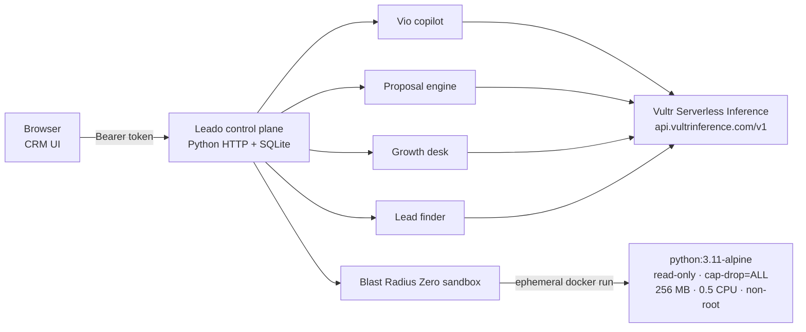

# Leado 2.0

> Autonomous sales operations and a sandboxed agent workforce — from lead discovery to signed scope of work.

[](https://github.com/Muhammad-Tayyab-Bhutto/Leado/actions/workflows/ci.yml)
[](https://github.com/Muhammad-Tayyab-Bhutto/Leado/actions/workflows/deploy.yml)
[](https://www.python.org/)
[](Dockerfile)
[](LICENSE)

**Leado 2.0** is an AI sales-operations platform for agencies, B2B SaaS, and IT
service providers. It runs the full revenue lifecycle in one control plane:

- multi-source lead discovery and technographic research,
- evidence-gated, human-in-the-loop email outreach,
- a CRM pipeline with approvals, suppression, and compliance gates,
- 1-click Statement of Work (SOW) proposal generation,
- **Vio**, an in-CRM copilot that queries and acts on the pipeline,
- **Blast Radius Zero**, an ephemeral sandbox for untrusted site audits.

Built for the **LabLab × Vultr Agent Rush Hackathon 2026** and designed to run on
a single **Vultr Cloud Compute** instance with **Vultr Serverless Inference**.

---

## Architecture



| Layer | Responsibility |
|---|---|
| **Control plane** | `app.py` + `crm.py` — SQLite store, scoring, REST API, and the single-page UI. |
| **Inference** | Vultr Serverless Inference (`meta/llama-3.1-70b-instruct`), with OpenRouter as an optional fallback. |
| **Sandbox** | `sandbox.py` — throwaway containers for untrusted audits with zero host secrets. |
| **Delivery** | Docker Compose on Vultr Cloud Compute, deployed by `deploy_vultr.sh` or GitHub Actions. |

---

## Highlights

| Capability | What it does |
|---|---|
| 🔍 **Lead discovery** | Discovers prospects across search, GitHub, job boards, and B2B directories; detects frontend, CMS, CDN, and API signals. |
| 🛡️ **Blast Radius Zero** | Audits run in ephemeral containers with `--read-only`, `--cap-drop=ALL`, 256 MB RAM, 0.5 CPU, an 8 s timeout, and a scrubbed environment. |
| 📄 **Proposal intelligence** | Turns diagnostic evidence into an executive SOW with a 3-phase scope and three pricing tiers. |
| 📬 **Compliant outreach** | Multi-variant drafts are blocked without verbatim evidence; every email needs human approval before SMTP. |
| 🤖 **Vio copilot** | Natural-language pipeline queries and one-click actions inside the CRM drawer. |
| 📊 **Pipeline CRM** | Kanban and table views, approvals, activity timeline, CSV export, and suppression lists. |
| 🧪 **Self-verifying security** | `GET /api/sandbox/status` runs a live containment test and reports PASS/FAIL. |

---

## Quick start

### Docker (recommended)

```bash
git clone https://github.com/Muhammad-Tayyab-Bhutto/Leado.git
cd Leado

cp .env.example .env
# Set SOFTORASYSTEMS_TOKEN to a random 16+ character secret.
# Add VULTR_INFERENCE_API_KEY or OPENROUTER_API_KEY for AI features.

docker compose up --build
```

Open <http://localhost:8000> and enter your access token.

### Local Python

```bash
python3 -m venv .venv
source .venv/bin/activate
pip install -r requirements.txt

cp .env.example .env
export SOFTORASYSTEMS_TOKEN="$(openssl rand -hex 24)"
python app.py serve 8000
```

### Seed demo data (optional)

```bash
python seed_demo_pipeline.py
```

This creates a realistic pipeline with scored leads, evidence, proposals, and
draft emails. Databases are local-only and git-ignored.

---

## Configuration

All settings live in `.env` (see [`.env.example`](.env.example)). The minimum
required value is a login token of at least 16 characters.

| Variable | Required | Purpose |
|---|---|---|
| `SOFTORASYSTEMS_TOKEN` | ✅ | Bearer token for the UI and API. Generated automatically by the deploy script. |
| `VULTR_INFERENCE_API_KEY` | Recommended | Enables Vultr Serverless Inference. |
| `VULTR_MODEL` | — | Defaults to `meta/llama-3.1-70b-instruct`. |
| `OPENROUTER_API_KEY` | — | Fallback LLM provider. |
| `OPENROUTER_MODEL` | — | Fallback model name. |
| `SOFTORASYSTEMS_ADDRESS` | Recommended | Physical address injected into outreach for CAN-SPAM/GDPR compliance. |
| `GROWTH_SENDER_NAME` / `GROWTH_SENDER_EMAIL` / `GROWTH_POSTAL_ADDRESS` | Recommended | Growth-desk sender identity. |
| `SOFTORA_HOST` / `SOFTORA_PORT` | — | Bind address and port (default `127.0.0.1:8000`; Compose sets `0.0.0.0`). |
| `DOMAIN` | Recommended | Public hostname. When set, `deploy_vultr.sh` starts Caddy and provisions HTTPS automatically. |

Optional data-provider keys (`HUNTER_API_KEY`, `SERPAPI_API_KEY`,
`CLEARBIT_API_KEY`, `CRUNCHBASE_API_KEY`, CAPTCHA solvers, SMTP) are read from
the same file. Missing keys disable only the corresponding integration.

---

## Deploy to Vultr

The full runbook is in **[`DEPLOY_VULTR.md`](DEPLOY_VULTR.md)**. Short version:

1. Launch **Ubuntu 24.04 LTS x64** (or Debian 12/13) on Cloud Compute (1 vCPU / 2 GB recommended).
2. Allow ports **22, 80, 443** in the Vultr firewall group.
3. Copy the project to `/opt/leado`.
4. Set `DOMAIN` in `.env` for automatic HTTPS, or leave it blank for plain HTTP.
5. Run:

```bash
cd /opt/leado
chmod +x deploy_vultr.sh
./deploy_vultr.sh
```

The script installs Docker, configures `ufw`, generates a token, builds the
image, and verifies health. With `DOMAIN` set it starts **Caddy** on 80/443 and
obtains a Let's Encrypt certificate automatically; the app itself is bound to
`127.0.0.1:8000`. Without a domain it publishes the app on port 80.

**Current production target:** Vultr Cloud Compute (Mumbai, `65.20.76.188`) at
`https://leado.softorasystems.com` — point an `A` record for `leado` at that IP.

---

## CI/CD

Two GitHub Actions workflows ship with the repo:

### `ci.yml` — every push and pull request

- byte-compiles all Python sources,
- runs the smoke suite on Python 3.11 and 3.12,
- builds the Docker image,
- starts the container and verifies the UI, `401` without a token, and `200`
  with one.

### `deploy.yml` — deployment to Vultr

Triggered manually, or automatically on `main` once enabled.

Configure these in **Settings → Secrets and variables → Actions**:

| Kind | Name | Value |
|---|---|---|
| Secret | `VULTR_HOST` | VM public IP or hostname |
| Secret | `VULTR_USER` | SSH user (use `root`, or a user with passwordless sudo) |
| Secret | `VULTR_SSH_KEY` | Private key whose public key is on the VM |
| Secret | `VULTR_PORT` | Optional, defaults to `22` |
| Variable | `DEPLOY_ENABLED` | Set to `true` to deploy automatically on `main` |

The workflow rsyncs the tree (excluding `.env` and databases), then runs
`deploy_vultr.sh` over SSH. Existing server-side `.env` and SQLite data are
preserved.

---

## Security model

Leado treats every external website and model-generated inspection script as
untrusted.

- **Ephemeral execution** — audits run in a fresh container that is destroyed
  after the run.
- **Resource limits** — 256 MB memory, 0.5 CPU, 64 PID limit, 8–10 s timeout.
- **Least privilege** — `--read-only`, `--cap-drop=ALL`,
  `--security-opt=no-new-privileges`, and a non-root UID.
- **Secret hygiene** — no host environment variables are forwarded; the
  containment test checks for app credentials and `/etc/shadow` access.
- **Token auth** — every API route except the public UI shell requires a
  `Bearer` token; the token is never embedded in the UI.
- **Human-in-the-loop** — no email is sent without explicit approval, and
  suppression lists are enforced.

Verify containment on a running instance:

```bash
curl -H "Authorization: Bearer $SOFTORASYSTEMS_TOKEN" \
  http://localhost:8000/api/sandbox/status
```

```json
{
  "status": "PASSED",
  "details": {
    "read_host_etc": false,
    "access_env_secrets": false,
    "contained": true,
    "sandbox_type": "docker_isolated"
  }
}
```

---

## API surface

All routes except `GET /` and `GET /favicon.ico` require
`Authorization: Bearer <token>`.

| Group | Endpoints |
|---|---|
| Pipeline | `GET /api/stats`, `GET /api/facets`, `GET /api/leads`, `GET/PATCH /api/leads/{id}` |
| Workflow | `POST /api/leads/{id}/status`, `/note`, `/reply`, `/draft`, `/research`, `/ai-draft`, `/classify-reply` |
| Email | `GET /api/emails`, `PATCH /api/emails/{id}`, `POST /api/emails/{id}/send` |
| Proposals | `GET /api/proposals`, `GET/POST /api/leads/{id}/proposal`, `PATCH /api/proposals/{id}` |
| Sandbox | `GET /api/sandbox/status`, `POST /api/leads/{id}/sandbox-audit` |
| Copilot / voice | `POST /api/copilot/chat`, `GET /api/copilot/suggestions`, `GET /api/voice/state`, `POST /api/voice/talk` |
| Growth desk | `GET /api/growth/desk`, `POST /api/growth/leads`, `POST /api/growth/leads/{id}/drafts`, `/touch`, `/opt-out` |
| Lead finder / bulk | `/api/lead_finder/*`, `/api/bulk/*` |
| Export | `GET /api/export.csv` |

---

## Project layout

```text
.
├── app.py                  # SQLite schema, scoring, drafting, compliance
├── crm.py                  # HTTP server, REST API, UI host
├── agent.py                # Vultr Serverless Inference + OpenRouter client
├── copilot.py              # Vio copilot
├── proposal_engine.py      # SOW generation
├── sandbox.py              # Blast Radius Zero execution engine
├── growth.py               # Growth desk
├── workforce.py            # Agent workforce orchestration
├── lead_finder/            # Discovery, enrichment, stealth, bulk jobs
├── ui.html                 # Single-page CRM interface
├── tests/                  # Smoke + containment tests
├── Dockerfile
├── docker-compose.yml
├── deploy_vultr.sh
└── .github/workflows/      # CI and Vultr CD
```

---

## Testing

```bash
pip install -r requirements.txt
SANDBOX_DISABLE_DOCKER=1 python -m unittest discover -s tests -v
```

The suite starts the real HTTP server on an ephemeral port, checks token auth,
verifies the public UI contains no embedded credentials, and runs the
containment proof. It needs no API keys or network access.

---

## Hackathon context

| Track | How Leado addresses it |
|---|---|
| **Powering the Future of Work** | End-to-end sales operations: discovery → audit → CRM → proposal → approved outreach. |
| **Blast Radius Zero** | Every untrusted audit runs in an ephemeral, capability-stripped container with a live containment proof. |
| **Vultr Cloud Compute** | Single-VM Docker Compose deployment with one-command provisioning. |
| **Vultr Serverless Inference** | Native client for `https://api.vultrinference.com/v1`, no GPU provisioning. |

---

## License

[MIT](LICENSE) © 2026 Muhammad Tayyab Bhutto.
