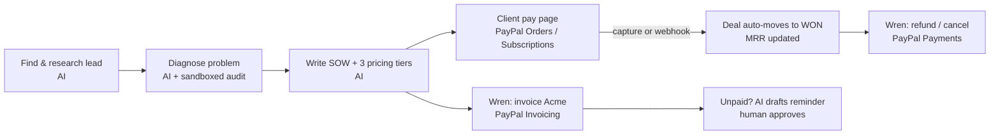

# Dealwright: AI quote-to-cash on PayPal

> An AI sales agent that finds a client, diagnoses their problem, writes the proposal, and gets it **paid through PayPal**, with a human approving every step that moves money.

[](https://github.com/Muhammad-Tayyab-Bhutto/Dealwright/actions/workflows/ci.yml)
[](https://www.python.org/)
[](https://developer.paypal.com/)
[](LICENSE)

Agencies and B2B service teams lose deals in the gap between *"proposal sent"*
and *"got paid"*. Proposals sit in PDFs, invoices go out days later, and nobody
chases the unpaid ones. Dealwright closes that gap:



## What it does

| Step | What happens | AI | PayPal |
|---|---|---|---|
| 1. Discover | Multi-source lead discovery and technographic research | LLM research and scoring | |
| 2. Propose | Executive SOW with a 3-phase scope and three pricing tiers | LLM writes the summary from audit evidence | |
| 3. **Get paid** | One click creates a client pay link. One-time tiers check out with **Orders v2**; monthly tiers create a **product, plan and subscription** on the fly | | Orders v2, Subscriptions v1 |
| 4. **Close the deal** | On capture (return URL) or a **signature-verified webhook**, the lead moves to WON, MRR or project value is recorded, and the timeline is updated | | Webhooks, verify-webhook-signature |
| 5. **Agentic billing** | Ask **Wren**: *"invoice FinFlow for the monthly plan"*, *"who owes us money?"*, *"refund DataStream"* | An LLM tool router picks the PayPal tool and extracts the company and tier | Invoicing v2, Refunds, Subscription cancel |
| 6. **AI collections** | For outstanding payments, the AI writes a reminder whose tone matches how long the payment has been open, with the pay link, and queues it in **Approvals** | LLM writes the reminder | Pay link / invoice link |

**Safety model: the AI proposes, a person approves, PayPal executes.** Wren
never moves money on its own. Invoices, refunds and cancellations come back as
confirmation buttons, and the API rejects them without `confirm: true`.
Reminder emails go through the existing human-approval and suppression gates.

## Quick start for judges (about 10 minutes)

### 1. PayPal sandbox credentials
1. Sign in at <https://developer.paypal.com>, then go to **Apps & Credentials** → **Sandbox** → **Create App**.
2. Copy the **Client ID** and **Secret**.
3. Under **Testing Tools → Sandbox Accounts**, note the **Personal** account email and password. You'll use it to pay as the client.

### 2. Check your PayPal keys (about 30 seconds)
```bash
python scripts/paypal_selfcheck.py   # PASS/FAIL for OAuth, Orders, Subscriptions, Invoicing, Webhooks (sandbox only)
```

### 3. Run
```bash
git clone https://github.com/Muhammad-Tayyab-Bhutto/Dealwright.git && cd Dealwright
cp .env.example .env
#   SOFTORASYSTEMS_TOKEN=<any 16+ char secret>
#   PAYPAL_CLIENT_ID=...  PAYPAL_CLIENT_SECRET=...
#   OPENROUTER_API_KEY=... OPENROUTER_MODEL=<a fast chat model>   (optional; AI falls back to templates)
python3 -m venv .venv && . .venv/bin/activate
pip install -r requirements.txt
python seed_demo_pipeline.py          # 5 demo leads with proposals
python app.py serve 8000
```
Or run `docker compose up --build`. Open <http://localhost:8000> and enter your token.

### 4. Try the flow
1. **Proposals** → open any proposal → **💳 PayPal checkout link** → open the link in a private window.
2. Pick a tier → **Pay with PayPal** → sign in with the sandbox **Personal** account → approve.
3. You land on the confirmation page. In the CRM, the lead is now **WON** and appears in **PayPal Payments** with its capture ID.
4. **Wren AI Copilot** → *"Who still owes us money on PayPal?"* → **AI reminder**, then *"invoice CloudPulse for the monthly growth plan"* → confirm.
5. **PayPal Payments** → **Refund** (or **Cancel** for subscriptions).

Webhooks are optional locally, because the buyer return URL captures the
payment. When the app is deployed, add a webhook in your PayPal app pointing to
`https://<host>/api/paypal/webhook` and set `PAYPAL_WEBHOOK_ID`.

### Hosted demo
Deploy with **Render**: `render.yaml` is a ready Blueprint. Set
`PUBLIC_BASE_URL` to the Render URL so PayPal return links point back to it.

## Tools used

| Tool | How it's used |
|---|---|
| **PayPal Orders v2** | One-time tier checkout: create the order with return/cancel URLs, then capture on return. Idempotency keys on create, capture and refund. |
| **PayPal Subscriptions v1** | Monthly tiers: a catalog product, billing plan and subscription are created from the AI-priced tier. |
| **PayPal Invoicing v2** | Wren's `send_invoice` tool: draft and send an invoice to the lead's contact. |
| **PayPal Payments v2** | Refunds of captured payments; cancelling subscriptions. |
| **PayPal Webhooks** | `PAYMENT.CAPTURE.COMPLETED/REFUNDED`, `BILLING.SUBSCRIPTION.ACTIVATED/CANCELLED`, `PAYMENT.SALE.COMPLETED`, `INVOICING.INVOICE.PAID`. Each event is checked with `verify-webhook-signature` and de-duplicated by event ID. |
| **AG Grid Community** (v33) | The PayPal Payments ledger: sorting, floating filters, number filters on amount and age, status pills, inline Sync / AI reminder / Refund actions, and amber highlighting for payments open more than 7 days. Falls back to a plain table if the CDN is unreachable. |
| **Render** | `render.yaml` Blueprint for a hosted demo (seeds demo data on boot). |
| **LLM via OpenRouter** (any model, e.g. Claude, GPT, Llama), or Vultr Serverless Inference | Lead research and scoring, proposal executive summaries, Wren's tool router (JSON tool selection plus company and tier extraction), and the collections agent that writes reminders. If no key is set, everything falls back to deterministic logic. |

## Architecture

| File | Role |
|---|---|
| `paypal.py` | PayPal REST client (OAuth token cache), checkout, subscriptions, invoicing, refunds, sync, webhooks, AI reminders |
| `paypal_web.py` | Public client pay page, scoped to an unguessable per-proposal token |
| `copilot.py` | Wren: LLM tool router plus PayPal tools, with confirmation gating |
| `crm.py` | HTTP server and REST API. Public routes are only `/`, `/pay/<token>…` and `/api/paypal/webhook` |
| `proposal_engine.py` | SOW plus pricing tiers (now with numeric `amount` / `interval` for PayPal) |
| `agent.py` | LLM client (OpenRouter / Vultr) with a circuit breaker and daily cap |
| `ui.html` | Single-page CRM: pipeline, proposals, **PayPal Payments**, Wren |
| `app.py`, `lead_finder/`, `sandbox.py`, `growth.py`, `workforce.py` | Discovery, scoring, sandboxed audits, outreach |

### PayPal API surface
| Route | Auth | Purpose |
|---|---|---|
| `GET /pay/{token}` | public (token) | Client proposal and pricing with PayPal buttons |
| `POST /pay/{token}/checkout` | public (token) | Create the order or subscription, then 303 redirect to PayPal |
| `GET /pay/{token}/return` | public (token) | Capture the order / confirm the subscription, then mark WON |
| `POST /api/paypal/webhook` | PayPal signature | Event sync |
| `GET /api/paypal/status`, `GET /api/payments` | bearer | Status, ledger, collected / MRR / outstanding |
| `POST /api/proposals/{id}/paylink` | bearer | Create the client pay link |
| `POST /api/leads/{id}/invoice` | bearer + `confirm` | Send a PayPal invoice |
| `POST /api/payments/{id}/refund` | bearer + `confirm` | Refund or cancel |
| `POST /api/payments/{id}/sync` | bearer | Pull the latest state from PayPal |
| `POST /api/payments/{id}/remind` | bearer | AI collections draft (queued for approval) |

## Responsible by design

- **Money:** the AI proposes, a person confirms, and PayPal executes. Money-moving APIs require `confirm: true`. Pay links are unguessable, scoped to one proposal, throttled, and can't be paid twice. Internal lead scores are never shown on client pages.
- **Webhooks:** every event is verified with PayPal's `verify-webhook-signature` and de-duplicated by event ID.
- **Crawling:** the crawler uses an honest user agent and robots.txt checks, rate-limits with backoff, and uses **no** proxy or user-agent rotation. **CAPTCHAs are never solved**: a bot challenge means the site is skipped. No LinkedIn scraping.
- **Outreach:** every email (cold or collections) needs human approval and goes through suppression lists and CAN-SPAM address checks.
- **Untrusted audits** run in a throwaway container with no host environment variables. The live containment proof checks that no PayPal, LLM or app secrets are visible.

## Testing

```bash
SANDBOX_DISABLE_DOCKER=1 python -m unittest discover -s tests -v
```

`lead_finder/tests.py` checks the polite-crawling guarantees.
`tests/test_paypal.py` runs the full quote-to-cash flow over real HTTP against
an in-memory fake PayPal API. It covers pay link → checkout redirect → capture →
WON, subscription → MRR, the invoice confirmation gate, the AI reminder draft,
refunds, idempotent returns, rejection of unsigned webhooks, and Wren's
routing of money actions to confirmations. No keys or network needed.

## Built during the PayPal hackathon

This is an existing project that we substantially extended for this hackathon,
as the rules allow. It started as an AI lead-generation CRM called "Dealwright"
(discovery, research, proposals, sandboxed audits; first commit 2026-11-09).
It had **no payment functionality**. During this hackathon we:

- **added the whole money side:** `paypal.py`, `paypal_web.py`, the PayPal
  Payments view, Wren's PayPal tools and LLM tool router, the AI collections
  agent, the webhook pipeline, and machine-readable pricing tiers;
- **made crawling compliant:** removed the CAPTCHA-solving integrations, the
  proxy and user-agent rotation, and LinkedIn scraping. The crawler now uses an
  honest user agent, rate-limits itself, and skips any site that shows a bot
  challenge (`lead_finder/politeness.py`, `lead_finder/captcha.py`);
- **renamed the product** to Dealwright to avoid confusion with unrelated
  products called Dealwright;
- added `render.yaml` and `tests/test_paypal.py`.

Every change is in the git history after commit `884006f`.

## Self-hosting on a VM

`deploy_vultr.sh` and `DEPLOY_VULTR.md` still provide a one-command Docker +
Caddy (automatic HTTPS) deployment on any Ubuntu/Debian VM.

## License

[MIT](LICENSE) © 2026 Muhammad Tayyab Bhutto.
